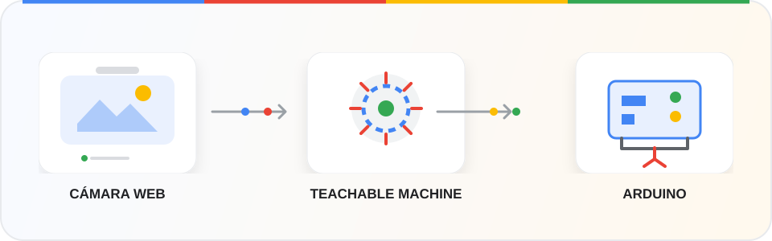

<div align="center">



# GDG · Visión por computadora + Arduino

### De un gesto frente a la cámara a una acción en el mundo real.

Una demo educativa para explorar **IA en el navegador**, modelos de [Teachable Machine](https://teachablemachine.withgoogle.com/) y hardware accesible con Arduino.

<p>
  
  
  
</p>

[Empezar](#-puesta-en-marcha) · [Cableado](#-conexiones) · [Cómo funciona](#-cómo-funciona) · [Comandos](#-comandos-seriales)

</div>

---

## La idea

Entrena un modelo de imágenes con tus propias clases y úsalo desde una página web. Cuando la cámara reconoce una clase con suficiente confianza, la app envía un carácter por USB serial y Arduino responde con un tono o moviendo un servo.

```text
  Cámara web       Teachable Machine       Navegador        USB serial       Arduino
     📷        →    reconoce una clase  →   decide acción  →   '1'…'5'    →   🔊  ↻
```

**No necesitas instalar Python ni ejecutar un servidor de IA:** las predicciones se hacen en el navegador con TensorFlow.js.

## Qué necesitas

- Node.js y npm.
- Chrome o Edge en `localhost` o en un sitio con HTTPS.
- Una cámara web y un modelo **Image Project** publicado en Teachable Machine.
- Una placa Arduino compatible, un buzzer y un servomotor.

## Puesta en marcha

### 1. Prepara el modelo

En [Teachable Machine](https://teachablemachine.withgoogle.com/), crea un **Image Project**, agrega clases, toma ejemplos y entrena. Copia la URL del modelo exportado. Para que el control sea estable, incluye ejemplos variados y una clase de reposo (por ejemplo, “Sin objeto”).

### 2. Prepara Arduino

Abre `arduino/tono_serial/tono_serial.ino` en Arduino IDE y súbelo a la placa. Conecta el buzzer al pin **8** y la señal del servo al pin **9**. Comparte GND entre la placa y los componentes; sigue las especificaciones de alimentación de tu servo.

### 3. Ejecuta la app

```bash
npm install
npm run dev
```

Abre la dirección local que muestra Vite (normalmente `http://localhost:5173`) en Chrome o Edge.

### 4. Conecta todo

1. Pega la URL del modelo y pulsa **Cargar modelo y cámara**; acepta el permiso de cámara.
2. Pulsa **Conectar Arduino** y selecciona el puerto de la placa.
3. En **Mapeo clase → comando**, asigna una acción a cada clase y ajusta el umbral de confianza.
4. Prueba cada clase frente a la cámara y observa la predicción y el comando en el panel.

## 🔌 Conexiones

| Componente | Arduino | Nota |
|:--|:--|:--|
| Buzzer | Pin digital **8** | Tono agudo o grave; reposo lo silencia. |
| Señal del servo | Pin **9** | Ángulos de 0°, 90° y 180°. |
| GND | GND | Tierra común. |

Comprueba el voltaje y el consumo del servo antes de alimentarlo desde la placa. Si usas una fuente externa, une su GND con GND de Arduino.

## Cómo funciona

1. TensorFlow.js y Teachable Machine cargan el modelo de imágenes en la página.
2. La cámara entrega cuadros al modelo, que calcula una probabilidad para cada clase.
3. La app muestra la clase con mayor probabilidad y solo ejecuta su acción si supera el umbral (85% por defecto).
4. Si ninguna clase supera el umbral, envía `0` para volver al reposo.
5. Web Serial transmite el comando a 9600 baudios; el firmware controla el buzzer y el servo.

## Comandos seriales

| Carácter | Acción |
|:--:|:--|
| `0` | Silencia el buzzer (reposo). |
| `1` | Tono agudo, 1500 Hz. |
| `2` | Tono grave, 300 Hz. |
| `3` | Servo a 0° (izquierda). |
| `4` | Servo a 180° (derecha). |
| `5` | Servo a 90° (frente). |

La app evita reenviar un comando mientras no cambie. Puedes combinar sonidos y movimientos modificando el firmware.

## Tecnologías

`TypeScript` · `Vite` · `TensorFlow.js` · `Teachable Machine` · `Web Serial API` · `Arduino`

## Hecho para aprender en comunidad

Este proyecto es una actividad práctica para descubrir cómo una idea de IA puede cruzar la pantalla y convertirse en una interacción física. Explóralo, cambia las clases y comparte lo que construyas con tu comunidad **Google Developer Groups**.

<div align="center">
  <sub>GDG Pacífico</sub>
</div>
